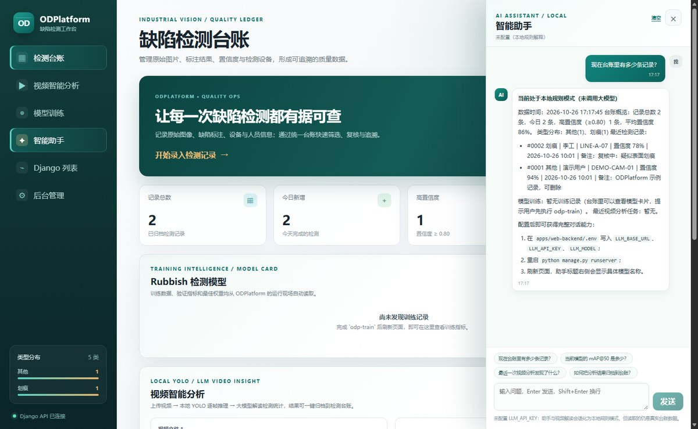
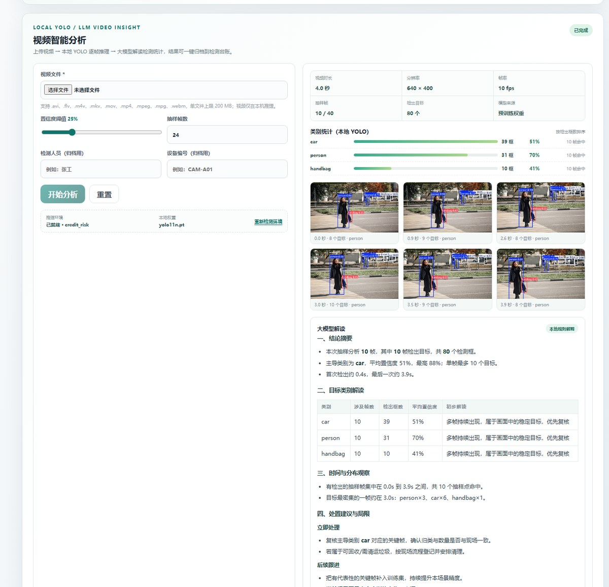

# 智能助手 + 视频 YOLO 推理 → 大模型解读

对应任务：

- **4.1 添加智能助手**：工作台右侧抽屉里的对话助手，回答基于台账、模型指标和历史视频分析的实时数据。
- **4.2 上传视频，本地 YOLO 推理识别后给大模型去解释**：上传视频 → 本机 YOLO 逐帧抽样推理 → 结构化统计 → 大模型生成中文质检报告 → 可一键归档成检测台账记录。

## 0. 效果示意

智能助手（回答内容来自真实台账；未配置 Key 时会明确标注「本地规则解释」）：



视频智能分析（左：上传与参数；右：本地 YOLO 类别统计、带框关键帧、解读报告、一键归档）。
图为**未配置 LLM_API_KEY 时的本地规则模式**，配上 Key 后同一位置会换成大模型的 Markdown 报告：



> 截图用的是演示视频（一张街景图做平移缩放），因此类别是通用 COCO 的 car/person/handbag。
> 换成 `models/trained/*-best.pt` 后，类别就会变成你训练的垃圾类别。

## 1. 链路总览

```text
浏览器
  │  ① POST /api/assistant/video/  (multipart, video)
  ▼
Django (apps/web-backend/assistant)
  │  ② VideoAnalysisJob 落库 + 后台线程
  │  ③ 启动独立进程：python yolo_worker.py --config job.json
  ▼
YOLO 推理环境（ultralytics + opencv + torch）
  │  ④ 均匀抽样 N 帧 → model.predict → 统计类别/帧数/置信度/关键帧
  │  ⑤ stdout 输出 @@ODP@@ 事件流（progress / result / error）
  ▼
Django
  │  ⑥ stats.summarize 汇总，写入 job.result
  │  ⑦ POST {LLM_BASE_URL}/chat/completions 让大模型解读（无 Key → 本地规则解释）
  ▼
前端轮询 GET /api/assistant/video/{id}/ → 进度条 / 关键帧 / Markdown 报告
  │  ⑧ POST /api/assistant/video/{id}/record/ → 归档成 defect.DefectRecord
  ▼
检测台账（列表、统计、Django 模板页同步可见）
```

智能助手对话走另一条更短的链路：

```text
POST /api/assistant/chat/ → context.build_context() 查询台账/模型/视频任务
                          → 作为 system 消息注入 → 大模型回答
                          → 无 Key 时返回「本地规则 + 真实台账快照」
```

## 2. 新增代码位置

```text
apps/web-backend/
├── .env.example                     大模型 / YOLO 配置样例（复制成 .env 使用）
├── assistant/
│   ├── models.py                    VideoAnalysisJob（视频分析任务与结果）
│   ├── api_views.py                 meta / chat / video / record 接口
│   ├── urls.py                      路由（挂在 /api/assistant/）
│   ├── llm.py                       OpenAI 兼容客户端（requests，不绑定 SDK）
│   ├── prompts.py                   助手 & 视频解读提示词
│   ├── context.py                   台账/模型/历史任务 → 上下文快照
│   ├── stats.py                     逐帧检测结果 → 类别统计（纯标准库，可单测）
│   ├── explain.py                   大模型不可用时的本地规则报告
│   ├── video.py                     任务调度、解释器/权重探测、子进程事件流
│   ├── yolo_worker.py               独立进程里的 YOLO 视频推理 worker
│   ├── admin.py                     后台可查看每个分析任务
│   ├── migrations/0001_initial.py   建表迁移
│   └── tests.py                     18 个测试
├── frontend/
│   ├── index.html                   视频分析面板 + 智能助手抽屉
│   └── static/frontend/
│       ├── assistant.js             助手/视频前端逻辑 + 轻量 Markdown 渲染
│       ├── app.js                   组装 assistant 模块（onMounted/onUnmounted）
│       └── styles.css               新增样式
scripts/
├── make_demo_video.py               生成演示视频（自带素材或参考图片）
└── run_web.ps1                      自动找 Web 解释器 + YOLO 解释器后启动
docs/
├── assistant-llm-video.md           本文档
└── images/                          界面截图
```

## 3. 启动步骤

### 3.1 安装 Web 依赖

```powershell
conda activate ODP            # 或使用任意装有 Python 3.10+ 的环境
cd C:\Users\NAYOUdUO\ourodplatform
python -m pip install -r ".\apps\web-backend\requirements.txt"
```

### 3.2 配置大模型

```powershell
cd apps\web-backend
Copy-Item .env.example .env
notepad .env
```

至少填一个可用的 Key：

```ini
LLM_PROVIDER=DeepSeek
LLM_BASE_URL=https://api.deepseek.com/v1
LLM_API_KEY=sk-你的key
LLM_MODEL=deepseek-chat
```

`.env` 已被 `.gitignore` 忽略，不会提交。换供应商只改这三行（OpenAI / 百炼 / 智谱 / 本地 Ollama 都兼容，示例见 `.env.example`）。
不填 Key 也能跑完整链路，只是解读由**本地规则**生成，界面上会明确标注「本地规则解释」。

### 3.3 准备 YOLO 推理环境

推理进程用的是「能 `import ultralytics, cv2`」的解释器，可以和 Web 环境不同。后端会按下列顺序自动探测：

1. `.env` 里的 `ODP_YOLO_PYTHON`
2. 当前 Web 进程的 `sys.executable`
3. `~/.conda/environments.txt` 里登记的所有 conda 环境
4. 常见安装位置（`~/anaconda3`、`~/miniconda3`、`C:\ProgramData\anaconda3`、`D:\Anaconda` 及其 `envs\*`）

本机的情况是：Web 跑在 `D:\Anaconda`（有 Django/torch），推理可以复用 `credit_risk` 环境（有 ultralytics/opencv）。最省事的做法是直接写死：

```ini
ODP_YOLO_PYTHON=D:\Anaconda\envs\credit_risk\python.exe
```

如果两个环境都没有 ultralytics，就装一个：

```powershell
python -m pip install ultralytics opencv-python
```

### 3.4 放权重（决定「识别什么」）

`assistant/video.resolve_model()` 的优先级：

1. `.env` 的 `ODP_VIDEO_MODEL`
2. `models/trained/*.pt`（新到旧）
3. `runs/training/*/weights/best.pt`
4. `models/pretrained/*.pt`
5. 都找不到 → 用 `yolo11n.pt`（首次自动下载，通用 COCO 类别）

**推荐**：先用项目自带脚本训练垃圾模型，再把产物放进 `models/trained/`：

```powershell
powershell -ExecutionPolicy Bypass -File .\scripts\train_rubbish.ps1 -Epochs 10 -Device 0
Copy-Item .\runs\training\<run>\weights\best.pt .\models\trained\
```

（若 `runs/training` 下有产物，第 3 条会自动命中，不必手动复制。）

### 3.5 启动

```powershell
powershell -ExecutionPolicy Bypass -File .\scripts\run_web.ps1
```

脚本会打印 Web 解释器与 YOLO 解释器，然后启动 `http://127.0.0.1:8000/`。首次运行会自动 `migrate`（创建 `assistant_videoanalysisjob` 表）。

页面上：

- 左侧导航 **视频智能分析** → 上传视频 → 填检测人员/设备（归档用）→ **开始分析**
- 右侧导航 **智能助手** 或右下角 ✦ 按钮 → 打开对话抽屉

## 4. 配置项（都在 `apps/web-backend/.env`）

| 变量 | 默认 | 说明 |
|---|---|---|
| `LLM_BASE_URL` | `https://api.deepseek.com/v1` | OpenAI 兼容根地址，自动拼 `/chat/completions` |
| `LLM_API_KEY` | 空 | 空 = 本地规则模式；也接受 `DEEPSEEK_API_KEY` / `OPENAI_API_KEY` |
| `LLM_MODEL` | `deepseek-chat` | 模型名 |
| `LLM_PROVIDER` | `DeepSeek` | 仅用于界面展示 |
| `LLM_TIMEOUT` | `120` | 秒（连接 10s + 读取） |
| `LLM_TEMPERATURE` | `0.3` | 越低越稳定 |
| `LLM_MAX_TOKENS` | `1600` | 报告长度上限 |
| `ODP_YOLO_PYTHON` | 自动 | 跑推理的 Python |
| `ODP_VIDEO_MODEL` | 自动 | 权重路径 |
| `ODP_VIDEO_DEVICE` | `cpu` | 有 CUDA 可改 `0` |
| `ODP_VIDEO_CONF` / `_IOU` / `_IMGSZ` | `0.25` / `0.7` / `640` | 与 ultralytics 同名参数 |
| `ODP_VIDEO_MAX_FRAMES` | `24` | 从整段视频均匀抽取的帧数 |
| `ODP_VIDEO_MAX_ANALYSIS_FRAMES` | `60` | 前端可提交的最大抽样帧数 |
| `ODP_VIDEO_MAX_KEYFRAMES` | `6` | 保存的标注关键帧数量 |
| `ODP_VIDEO_MAX_UPLOAD_MB` | `200` | 上传大小上限 |
| `ODP_VIDEO_TIME_BUDGET` | `600` | 单次推理时间预算，超时标记「结果被截断」 |

## 5. API

| 方法 | 地址 | 说明 |
|---|---|---|
| GET | `/api/assistant/meta/?probe=1` | 大模型配置状态、YOLO 解释器探测结果、权重、限制（`probe` 省略则不探测） |
| POST | `/api/assistant/chat/` | 入参 `{messages:[{role,content}]}`，返回 `{reply, engine, llm_configured}` |
| GET | `/api/assistant/video/` | 最近 8 个分析任务 |
| POST | `/api/assistant/video/` | multipart：`video`（必填）、`conf`、`max_frames`、`person`、`device` |
| GET | `/api/assistant/video/{id}/` | 任务进度/结果/解读（前端 1.5s 轮询） |
| POST | `/api/assistant/video/{id}/record/` | 把结果归档成检测记录（同一任务只能归档一次） |

`video` 任务返回结构（节选）：

```json
{
  "status": "completed",
  "progress": 100,
  "engine": "DeepSeek · deepseek-chat",
  "result": {
    "video": {"width": 640, "height": 400, "fps": 10, "duration_seconds": 4.0},
    "model": {"source": "trained", "class_count": 10},
    "summary": {
      "frames_analyzed": 10,
      "total_detections": 42,
      "classes": [{"name": "plastic_bottle", "frames": 7, "detections": 12, "avg_conf": 0.83}],
      "timeline": [{"frame": 0, "time": 0.0, "total": 2, "classes": {"plastic_bottle": 2}}]
    },
    "keyframes": [{"url": "/media/video_jobs/1/frames/kf_000012.jpg", "time": 0.4, "count": 3}],
    "warnings": []
  },
  "explanation": "## 一、结论摘要 ..."
}
```

只有这份**结构化统计 + 关键帧**会发给大模型，视频文件本身不出本机。

## 6. 演示与自测

```powershell
# 用项目里的示例图片生成一段带目标的演示视频（需要 opencv）
python scripts\make_demo_video.py --source <某张有物体的图片> --output runs\demo\demo.mp4

# 没有图片也可以：画移动的方块，用来验证上传/推理/解读全链路
python scripts\make_demo_video.py --output runs\demo\shapes.mp4
```

后端测试（不依赖 ultralytics，用 mock 隔离大模型与推理进程）：

```powershell
cd apps\web-backend
python manage.py test assistant -v 2
```

单独调试推理 worker（绕过 Django）：

```powershell
python apps\web-backend\assistant\yolo_worker.py --config job.json
```

## 7. 常见问题

**Q1：页面提示「缺少 ultralytics / opencv」**
说明没探测到推理环境。`.env` 里设置 `ODP_YOLO_PYTHON=<装了 ultralytics 的 python.exe>`，或在当前环境 `pip install ultralytics opencv-python`，然后点面板上的「重新检测环境」。

**Q2：大模型报 401 / 超时**
401 是 Key 无效或没有该模型权限；超时看 `LLM_TIMEOUT` 与网络代理。报错会显示在界面上（并自动回退到本地规则报告），`engine` 字段可区分是哪个模型出的报告。

**Q3：视频上传成功但没检出任何目标**
先确认权重是不是垃圾类别：通用 `yolo11n.pt` 只有 COCO 80 类（person/car/bottle…）。用 `models/trained/*-best.pt` 替换，或降低置信度阈值到 0.15~0.25 再试。

**Q4：长视频很慢**
默认只均匀抽 24 帧（不是逐帧），CPU 上通常几秒到几十秒。要更细就调大 `ODP_VIDEO_MAX_FRAMES`（同时受 `ODP_VIDEO_MAX_ANALYSIS_FRAMES` 限制），要更快就调小。超过 `ODP_VIDEO_TIME_BUDGET` 会停止抽帧并在 `warnings` 里标注。

**Q5：为什么视频分析要单独起进程？**
ultralytics/torch 体积大、可能与 Web 环境冲突，崩溃时也不该拖垮 Django；独立进程还能直接用另一个 conda 环境，并用 `time_budget` 保证不无限跑。
